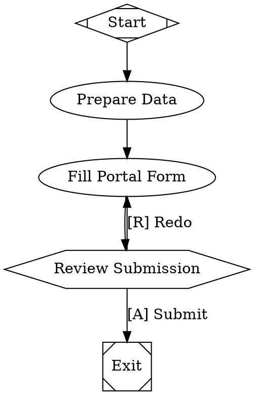

<Note>
VNC access requires the **Daytona** sandbox provider. Local, Docker, and exe.dev sandboxes do not support this feature.
</Note>

VNC (Virtual Network Computing) provides a graphical desktop environment inside Daytona sandboxes, accessible directly from your browser. This enables interaction with GUI applications, visual debugging, and observation of agent-driven desktop automation.

## Use cases

- GUI application testing. Interact with desktop apps built or modified by an agent
- Browser testing. Verify web applications in a full browser environment inside the sandbox
- Visual debugging. Inspect graphical output, rendered documents, or UI state
- Agent observation. Watch an AI agent perform automated desktop interactions

## How it works

Daytona provides VNC through its Computer Use capability, which starts a headless desktop inside the sandbox and returns a signed noVNC URL. Fabro exposes this as the run sandbox page's **VNC** panel and as `POST /api/v1/runs/{id}/sandbox/vnc`, which starts or ensures Computer Use for the run sandbox and returns a signed noVNC preview URL. To use it:

1. Start a run on a **Daytona** sandbox
2. Open the run's **Sandbox** view in the web UI and use the VNC panel (or call `POST /api/v1/runs/{id}/sandbox/vnc`)
3. Interact with the desktop using mouse and keyboard, or watch an agent automate it

## Example workflow

VNC is useful when the agent needs to interact with a GUI application that can't be driven through a CLI alone. This workflow automates filling out a legacy internal web form that requires browser interaction:

<Frame>
  
</Frame>

