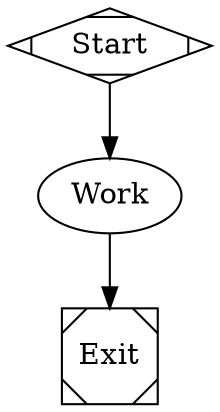

[Modal](https://modal.com/) serves inference through an OpenAI-compatible Shared API and through dedicated Auto Endpoints. Fabro ships a disabled `modal` provider entry with no built-in model rows; Modal assigns each workspace its own endpoint hostnames, so the available models come from your endpoint. Enable it after Modal gives you an endpoint URL.

## Prerequisites

- A [Modal account](https://modal.com/signup)
- A [Kimi K3 Shared API or Auto Endpoint](https://modal.com/library/moonshot/kimi-k3)
- A Modal proxy-token pair

## Create or select an endpoint

Use the Kimi K3 Shared API from the Modal model library, or create a dedicated Auto Endpoint:

```bash
modal endpoint create --model moonshotai/Kimi-K3
```

Find the endpoint URL in the Modal dashboard or with `modal endpoint list`. Modal serves its OpenAI-compatible API under `/v1`.

## Create a proxy token

Modal endpoints are authenticated with two headers. Create a proxy-token pair:

```bash
modal workspace proxy-tokens create
```

The command prints a token ID that starts with `wk-` and a secret that starts with `ws-`. Modal shows the secret only once, so save both values immediately.

If your Modal workspace uses RBAC, allow the token in the endpoint's environment:

```bash
modal workspace proxy-tokens allow wk-... main
```

## Enable the provider

Add the provider override to the settings file used by the Fabro server. Include `/v1` in the endpoint URL and omit a trailing slash.

```toml title="settings.toml"
_version = 1

[llm.providers.modal]
base_url = "https://your-endpoint.modal.run/v1"
enabled = true
```

Fabro ships the Shared Endpoint router (`https://inference.us-west.modal.direct/v1`) as the default `base_url`; override it only for a dedicated Auto Endpoint.

## Configure credentials

Store both proxy-token values in the target Fabro server vault:

```bash
fabro secret set MODAL_TOKEN_ID wk-...
fabro secret set MODAL_TOKEN_SECRET ws-...

# For a non-default remote server:
fabro secret --server https://your-fabro.example set MODAL_TOKEN_ID wk-...
fabro secret --server https://your-fabro.example set MODAL_TOKEN_SECRET ws-...
```

<Note>
  `fabro provider login --provider modal` is not supported in this release because that command accepts one credential value. Use the two `fabro secret set` commands above.
</Note>

Modal does not use a bearer API key for these endpoints. Fabro sends the vault values as `Modal-Key` and `Modal-Secret` headers and does not send an `Authorization` header.

## Included model

There is no built-in Modal model row. Modal's Shared Endpoint listing returns hostnames scoped to the caller's proxy token, so Fabro treats those hostnames as the model IDs (`modal/<endpoint-hostname>`). To use a built-in-style slug instead, add an operator row under `[llm.providers.modal.models.*]` in your own catalog overlay with Modal's exact endpoint model string as `api_model`.

## Use Kimi K3

Modal's own tooling lists the endpoint hostnames your proxy token can reach (for example `modal endpoint list`, or `GET {base}/models` against the endpoint). Select one as `modal/<endpoint-hostname>`, or the slug from an operator-defined row, when testing or running workflows. `fabro model list --provider modal` shows only operator-defined rows added to your catalog overlay:

```bash
fabro model test --provider modal --model modal/<endpoint-hostname>
fabro run workflow.fabro --provider modal --model modal/<endpoint-hostname>
```

When targeting a non-default remote server, pass the same `--server` value:

```bash
fabro model test --server https://your-fabro.example --provider modal --model modal/<endpoint-hostname>
```
In workflow stylesheets:



## Direct SDK environment credentials

The built-in Modal provider authenticates with two headers, `Modal-Key` and `Modal-Secret`, read from the secrets `MODAL_TOKEN_ID` and `MODAL_TOKEN_SECRET`. For environment-backed SDK use, export both names and select `VaultCredentialSource::environment_only()` explicitly. Alternatively, use `VaultCredentialSource::vault_only(...)` with a vault holding both tokens.

Enable Modal and set its endpoint URL in the `[llm]` overlay, then build the client with `fabro_llm::build_client` over your chosen credential source. The catalog you pass to the client must be built from the same settings file with `fabro_llm::build_catalog`.

```toml title="settings.toml"
[llm.providers.modal]
base_url = "https://your-endpoint.modal.run/v1"
enabled = true
```

## Costs

Fabro has no built-in Modal model prices. Costs for endpoint hostnames are Passthrough: each deployed endpoint is responsible for its own pricing, and Fabro does not ship an estimate for it.

Dedicated Auto Endpoints use Modal compute billing instead of Shared API token prices.

## Troubleshooting

**Modal requests fail with 404 on a dedicated Auto Endpoint**. Add that endpoint's URL as `base_url` under `[llm.providers.modal]`, including `/v1` and no trailing slash. Shared API users do not need to set `base_url`.

**Modal is not configured**. Set both `MODAL_TOKEN_ID` and `MODAL_TOKEN_SECRET` in the target server vault. One value is not sufficient.

**401 or 403**. Confirm that the token pair belongs to the correct Modal workspace and environment. If the workspace uses RBAC, allow the token in that environment.

**404**. Confirm that the base URL is the endpoint URL followed by `/v1`, with no trailing slash.

**Unknown model**. Confirm the selected endpoint hostname comes from Modal's endpoint listing (or the slug of an operator-defined row), then run `fabro model test --provider modal --model <model>`.

## Further reading

<Columns cols={2}>
  <Card title="Modal Kimi K3" icon="microchip" href="https://modal.com/library/moonshot/kimi-k3">
    Shared API prices, model specifications, and Auto Endpoint setup.
  </Card>
  <Card title="Modal endpoint authentication" icon="key" href="https://modal.com/docs/guide/endpoints#proxy-tokens">
    Proxy-token headers and endpoint calling conventions.
  </Card>
</Columns>
